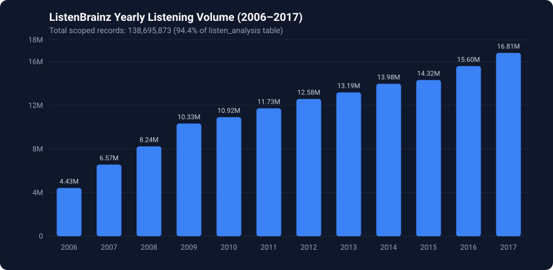
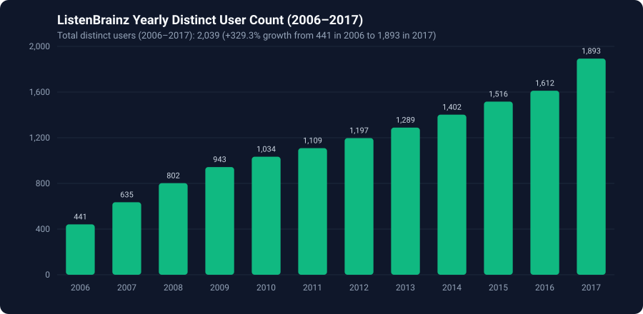
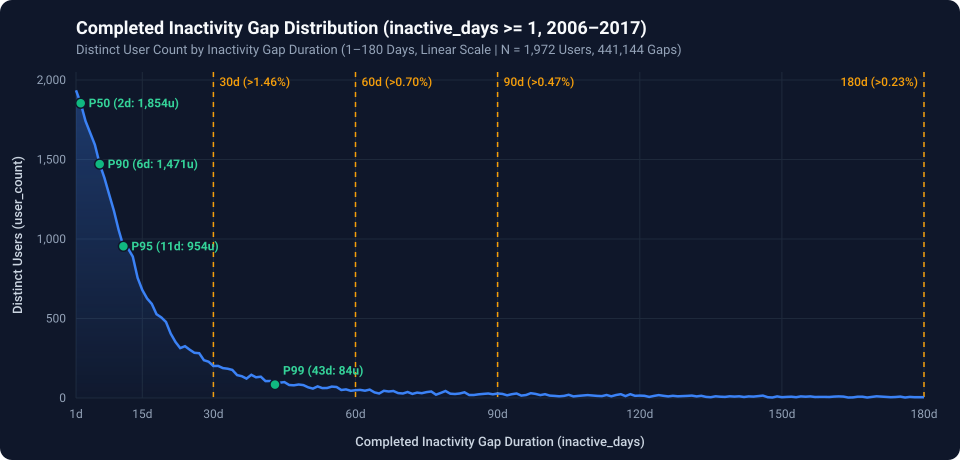

# ListenBrainz Behavioral Churn & Inactivity Gap Analysis (2006–2017)

Descriptive and percentile analysis of user listening activity in the `listenbrainz1.listenbrainz.listen_analysis` BigQuery dataset (**2006–2017 inclusive**) to establish an evidence-based behavioral churn threshold.

---

## Repository Structure

```text
ListenBrainz/
├── README.md                                        # Project overview & executive summary
├── docs/
│   ├── 01_data_scope_and_record_counts.md           # Step 1: Dataset scope, yearly record & user counts (2006–2017)
│   └── 02_inactivity_gap_analysis.md                # Step 2: Completed inactivity gap stats, percentiles & distributions
├── sql/
│   ├── 01_yearly_record_counts.sql                  # BigQuery SQL: Yearly record & distinct user counts (2006–2017)
│   ├── 02_inactivity_gap_summary_stats.sql          # BigQuery SQL: Inactivity gap summary & exact percentiles (>= 1d)
│   └── 03_users_inactive_90plus_days.sql            # BigQuery SQL: DDL for users_inactive_90plus_days table
├── data/
│   ├── yearly_record_counts_2006_2017.csv           # Yearly record & distinct user counts (12 rows)
│   ├── inactivity_gap_distribution_1_to_180d.csv    # Daily user & gap counts for inactive_days 1..180
│   └── users_inactive_90plus_days.csv               # All 853 users who returned after >= 90 inactive days
└── assets/
    ├── figures/                                     # Crisp SVG vector charts & 300-DPI PNG exports
    │   ├── yearly_record_counts.{svg,png}
    │   ├── yearly_distinct_users.{svg,png}
    │   ├── inactivity_gap_distribution_linear.{svg,png}
    │   ├── inactivity_gap_distribution_log.{svg,png}
    │   └── inactivity_gap_distribution_tail.{svg,png}
    └── interactive/
        └── inactivity_gaps_chart.html               # Interactive HTML chart (Linear / Log / Tail views + tooltips)
```

---

## Executive Summary of Findings

### Step 1: Dataset Scope (2006–2017)
- Out of **146,914,257** total records in `listenbrainz1.listenbrainz.listen_analysis`, **138,695,873 records (94.41%)** across **2,039 distinct users** fall within the **2006–2017 (inclusive)** analysis window.
- Annual listening volume grew steadily every year from **4.43M** listens in 2006 to **16.81M** listens in 2017.
- Annual distinct active users grew more than **4.2x** (+329.3%), rising every consecutive year from **441** users in 2006 to **1,893** users in 2017.
- Full details: [`docs/01_data_scope_and_record_counts.md`](docs/01_data_scope_and_record_counts.md)





---

### Step 2: Completed Inactivity Gap Statistics (`inactive_days >= 1`)
Multiple listens on the same UTC calendar day are collapsed into a single active day per user. Completed inactivity gaps between consecutive active days are measured as:

```sql
inactive_days = DATE_DIFF(next_active_date, active_date, DAY) - 1
```

Because back-to-back active days (`inactive_days = 0`, **84.04%** of transitions) represent continuous daily listening rather than inactivity, summary statistics are computed over **strictly positive completed inactivity gaps (`inactive_days >= 1`)**:

| Metric | Value |
| :--- | ---: |
| **Total Completed Gap Count (`inactive_days >= 1`)** | **441,144** |
| **Distinct Users Contributing** | **1,972** |
| **Mean (`inactive_days`)** | **4.71** days |
| **Standard Deviation (`inactive_days`)** | **35.17** days |
| **Median (P50)** | **2** days |
| **P75 Percentile** | **3** days |
| **P90 Percentile** | **6** days |
| **P95 Percentile** | **11** days |
| **P99 Percentile** | **43** days |
| **Gaps > 30 Days** | **1.46%** *(6,439 gaps)* |
| **Gaps > 60 Days** | **0.70%** *(3,106 gaps)* |
| **Gaps > 90 Days** | **0.47%** *(2,092 gaps)* |
| **Gaps > 180 Days** | **0.23%** *(1,029 gaps)* |



- Full step-by-step analysis, Log10 and 30–180d tail charts, and user-level return breakdowns: [`docs/02_inactivity_gap_analysis.md`](docs/02_inactivity_gap_analysis.md)
- Interactive chart widget: [`assets/interactive/inactivity_gaps_chart.html`](assets/interactive/inactivity_gaps_chart.html)
