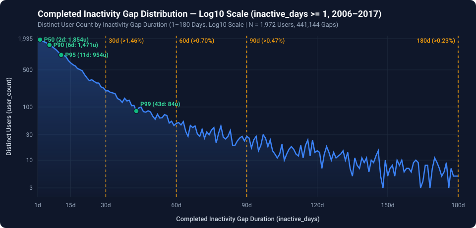
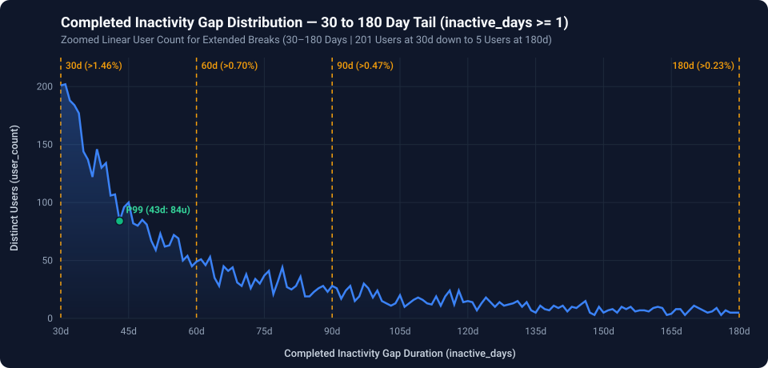

# Step 2: Completed Inactivity Gap Analysis & Behavioral Churn Thresholding

## 1. Methodology & Definitions
To establish an evidence-based behavioral churn threshold, we analyze completed inactivity gaps between consecutive active listening days for each user across **2006–2017**:

1. **Daily Aggregation**: Collapse multiple listens on the same UTC calendar day into a single active day per user (`active_date = DATE(listened_at)`).
2. **Chronological Ordering & Gap Calculation**: Order each user's active days chronologically and compute the number of inactive calendar days between consecutive active days:
   ```sql
   inactive_days = DATE_DIFF(next_active_date, active_date, DAY) - 1
   ```
3. **Completed Gaps Only (`next_active_date IS NOT NULL`)**: Exclude right-censored trailing periods after a user's final observed active day.
4. **Exclusion of Zero-Day Transitions (`inactive_days >= 1`)**:
   - Back-to-back active listening days yield `inactive_days = 0` (**2,322,640** transitions, or **84.04%** of all consecutive active-day pairs).
   - Because listening on consecutive calendar days represents continuous daily engagement rather than an inactivity break—and heavily zero-inflates percentile statistics—all descriptive statistics below are computed strictly over **true inactivity breaks (`inactive_days >= 1`)**.

---

## 2. Summary & Percentile Statistics (`inactive_days >= 1`)

| Metric | Value |
| :--- | ---: |
| **Total Completed Gap Count (`inactive_days >= 1`)** | **441,144** |
| **Distinct Users Contributing** | **1,972** |
| **Mean (`inactive_days`)** | **4.71** days |
| **Standard Deviation (`inactive_days`)** | **35.17** days |
| **Median (P50)** | **2** days |
| **P75 Percentile** | **3** days |
| **P90 Percentile** | **6** days |
| **P95 Percentile** | **11** days |
| **P99 Percentile** | **43** days |
| **Percentage of Completed Gaps > 30 Days** | **1.46%** *(6,439 gaps)* |
| **Percentage of Completed Gaps > 60 Days** | **0.70%** *(3,106 gaps)* |
| **Percentage of Completed Gaps > 90 Days** | **0.47%** *(2,092 gaps)* |
| **Percentage of Completed Gaps > 180 Days** | **0.23%** *(1,029 gaps)* |

---

## 3. Distribution Visualizations (1 to 180 Days)

### 3.1 Linear Scale (1–180 Days, Distinct User Count)


### 3.2 Log10 Scale (1–180 Days, Distinct User Count)


### 3.3 Zoomed Tail View (30–180 Days, Distinct User Count)


> **Interactive Widget**: Open [`assets/interactive/inactivity_gaps_chart.html`](../assets/interactive/inactivity_gaps_chart.html) in any browser to toggle scales dynamically and inspect day-by-day hover tooltips.

---

## 4. User-Level Return Behavior Across Candidate Churn Windows
While long breaks represent a small percentage of total gap events (**1.46%** exceed 30 days), over a 12-year observation window many users take at least one extended break and return:

| Inactivity Window (`inactive_days`) | Distinct Users Returning | % of Active User Base (N = 1,972) | Completed Gaps |
| :--- | ---: | ---: | ---: |
| **`30 <= inactive_days < 60`** *(returned between 30 and 59 days)* | **1,047** | **53.09%** | **3,522** |
| **`inactive_days > 60`** *(returned after > 60 days)* | **985** | **49.95%** | **3,106** |
| **`60 < inactive_days <= 90`** *(returned between 61 and 90 days)* | **572** | **29.01%** | **1,014** |
| **`inactive_days >= 90`** *(returned after >= 90 days)* | **853** | **43.26%** | **2,120** |
| **`inactive_days >= 180`** *(returned after >= 180 days)* | **611** | **30.98%** | **1,034** |
| **`inactive_days >= 365`** *(returned after >= 1 year)* | **368** | **18.66%** | **469** |

- **BigQuery Table of >= 90-Day Returning Users**: Saved as `listenbrainz1.listenbrainz.users_inactive_90plus_days` (853 rows) and exported to [`data/users_inactive_90plus_days.csv`](../data/users_inactive_90plus_days.csv).

---

## 5. Reproducible SQL Queries
- Summary & Percentile Statistics: [`sql/02_inactivity_gap_summary_stats.sql`](../sql/02_inactivity_gap_summary_stats.sql)
- Returning Users (>= 90 Days) Table DDL: [`sql/03_users_inactive_90plus_days.sql`](../sql/03_users_inactive_90plus_days.sql)
